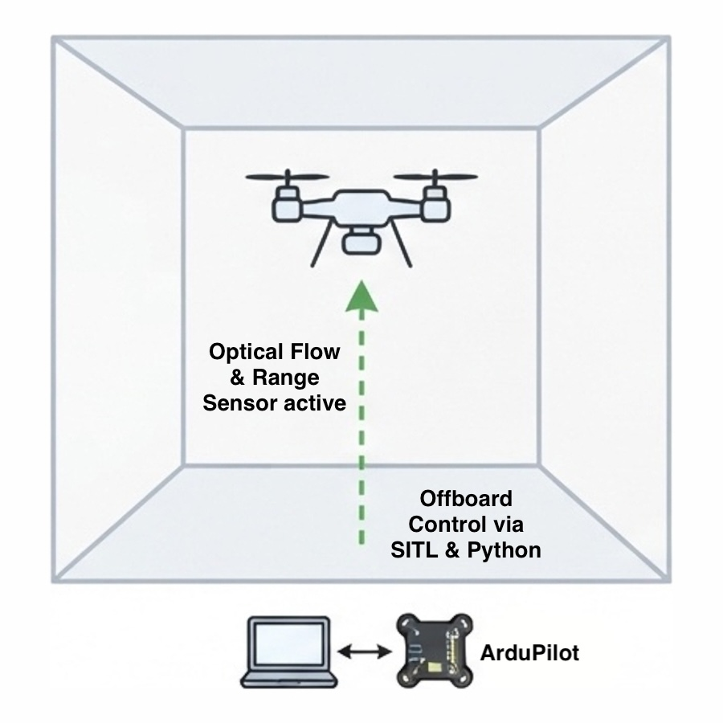
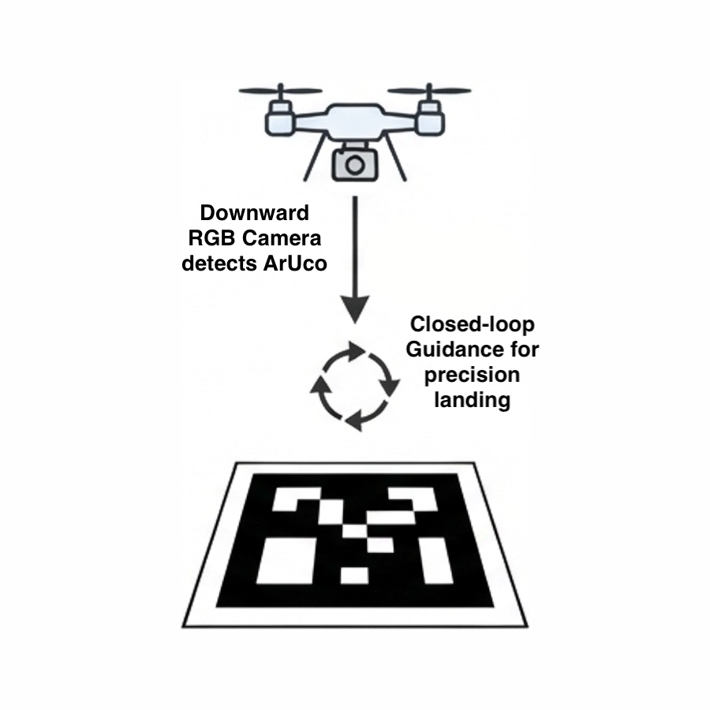
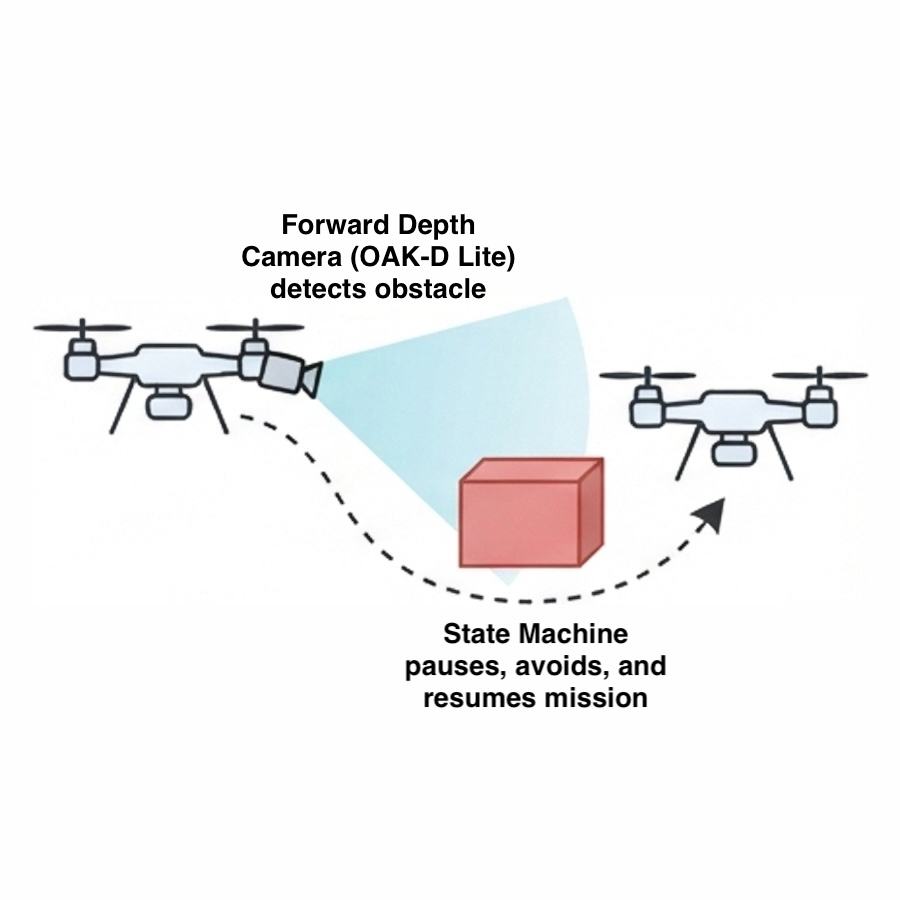

# Project Starling

**GPS-denied visual tracking, obstacle avoidance, and precision landing with an autonomous quadcopter.**

Project Starling is a modular UAV engineering project exploring how an open autopilot and an onboard companion computer can work together to navigate without GNSS, find and follow a visual target, and respond to obstacles. The project is being developed as a practical robotics portfolio, with simulation and measured milestones guiding each step toward a physical prototype.

> **Project status:** Planning. Hardware, configuration, and performance goals below are proposed and will be validated as the project develops.

<br />

## Goals

- Build an open, inspectable UAV platform around ArduPilot and companion-computer software.
- Establish stable indoor flight using optical flow and range sensing, without relying on GNSS position.
- Detect a visual landing target and guide the aircraft toward it using closed-loop control.
- Explore reactive obstacle detection and mission resumption as a later extension.
- Document design decisions, experiments, failures, and measured results in the repository.

<br />

## System overview

The flight controller is responsible for stabilization, state estimation, and motor control. A Raspberry Pi companion computer handles higher-level mission logic and computer vision, sending commands to the flight controller over MAVLink.

```text
Forward stereo camera ─┐
                       ├─> Companion computer (Raspberry Pi 5)
Downward RGB camera ───┘       OpenCV, target tracking, mission state machine
                                      │
                              MAVLink over UART
                                      │
Optical flow + range sensor ──> Flight controller (ArduPilot)
                                      │
                                  ESCs + motors
```

<br />

## Development layers

### Layer 1 — GPS-denied flight and offboard control



Establish the hardware and software foundation.

<br />

In simulation, connect a Python MAVLink client to ArduPilot SITL and demonstrate a controlled takeoff, hold, local movement, and landing.

<br />

On the physical platform, configure optical flow and a rangefinder for indoor state estimation, then validate manual and assisted flight before attempting companion-computer control.

<br />

**Milestone:** Repeatable simulated mission, followed by a stable indoor hover and a carefully bounded local movement on the physical aircraft.

<br clear="right"/>

### Layer 2 — Visual target tracking and landing



Use a downward-facing camera and OpenCV to detect an ArUco marker and estimate its relative pose.

<br />

Convert target-relative errors into bounded control commands, then evaluate target tracking and landing in simulation before physical trials.

<br />

**Milestone:** Documented landing-error measurements on a stationary target, followed by a moving-target experiment if the control behavior is reliable.

<br clear="right"/>

### Layer 3 — Obstacle avoidance and mission resumption



Add forward-facing depth sensing and an explicit mission state machine.

<br />

When an obstacle is detected in the planned path, pause the landing approach, perform a bounded avoidance maneuver, reacquire the target, and resume only when conditions permit.

<br />

**Milestone:** Demonstrate and measure a repeatable simulated obstacle response before attempting controlled physical tests.

<br clear="right"/>

A learned object detector in place of fiducial markers is a possible later extension, not a prerequisite for the core project.

<br />

## Proposed hardware

The following is a working bill of materials, subject to compatibility checks and bench testing before purchase or assembly.

| Subsystem              | Proposed component                                          | Role                                            |
| ---------------------- | ----------------------------------------------------------- | ----------------------------------------------- |
| Frame                  | TBS Source One V5 (5-inch) or Mark4 (7-inch)                | Airframe and payload mounting                   |
| Flight stack           | SpeedyBee F405 V4 stack or a compatible Holybro H7 stack    | ArduPilot flight control and ESC interface      |
| Motors                 | Four 2207 motors, approximately 1800–1950 KV for a 6S setup | Propulsion                                      |
| Companion computer     | Raspberry Pi 5 (8 GB) with dedicated regulated 5 V supply   | Vision and mission logic                        |
| Downward camera        | Raspberry Pi Camera Module 3                                | Fiducial detection and landing guidance         |
| Optical flow and range | Matek 3901-L0X                                              | Indoor horizontal velocity and altitude sensing |
| Forward depth camera   | Luxonis OAK-D Lite (Layer 3)                                | Depth perception and optional onboard inference |
| RC link                | RadioMaster Pocket with ExpressLRS receiver                 | Manual control and pilot takeover               |
| Power                  | 6S LiPo batteries and balance charger                       | Flight power                                    |

Component selection, wiring, power budget, payload, and flight time will be verified for the chosen frame and stack before the physical build.

<br />

## Software and development environment

- **Flight firmware:** ArduPilot (ArduCopter)
- **Simulation:** ArduPilot SITL on macOS, using Docker or an Ubuntu virtual machine
- **Ground station:** QGroundControl
- **Companion computer OS:** Ubuntu Server for Raspberry Pi (version to be confirmed against the selected dependencies)
- **Programming:** Python
- **Flight communication:** MAVLink via `pymavlink` or MAVSDK-Python
- **Vision:** OpenCV with ArUco support and NumPy
- **Depth sensing (Layer 3):** Luxonis DepthAI SDK

The initial development loop is simulation-first: run SITL, connect from a Python script, inspect telemetry in a ground station, and record the behavior before moving to hardware.

<br />

## Planned milestones

| Phase | Focus                            | Evidence of progress                                                    |
| ----- | -------------------------------- | ----------------------------------------------------------------------- |
| 1     | Development environment and SITL | Reproducible setup notes and a scripted simulated flight                |
| 2     | Airframe and manual flight       | Verified wiring, sensor setup, and stable manual flight                 |
| 3     | GPS-denied foundation            | Optical-flow-assisted indoor hover and bounded offboard control         |
| 4     | Target tracking and landing      | ArUco detection, closed-loop guidance, and recorded landing-error data  |
| 5     | Obstacle response                | Depth-based state transitions and repeatable avoidance/resumption tests |
| 6     | Portfolio release                | Demo video, architecture notes, measured results, and lessons learned   |

The original planning estimate is twelve weeks. Actual timing will depend on simulation results, component availability, integration work, and safe access to a suitable test space.

<br />

## Safety approach

This project involves a powerful aircraft and is developed incrementally. Simulation and bench validation come before autonomous flight. Physical tests will use an appropriate controlled area, conservative speed and altitude limits, and a pilot with an independent RC takeover path.

Before flight testing:

- Verify the airframe, propeller direction, motor order, failsafes, and RC takeover behavior.
- Confirm power wiring and regulator capacity; power the companion computer from a suitable dedicated supply.
- Configure and test loss-of-link, low-battery, and companion-computer failure responses.
- Keep props removed during bench work that does not require them.
- Follow current Finnish and EU UAS requirements and use a suitable test location.
- Do not treat example parameters or software behavior in project notes as a flight-ready configuration; validate them against the selected hardware and current ArduPilot documentation.

<br />

## Build log and results

This repository will record the project as it is built:

- Setup instructions and reproducible simulation steps
- Wiring diagrams and configuration notes
- Short experiment logs with expected and observed behavior
- Measured landing error, control-loop latency, and test conditions
- Video clips and visualizations where they help explain results
- Issues encountered and the changes made in response

Performance claims will be added only after they are supported by recorded tests.

<br />

## License

License to be selected before publishing reusable code or design files.

<br />

## Acknowledgments

Project Starling is named for the European starling (_Sturnus vulgaris_) and its coordinated flight. The name is a project inspiration; the initial system is a single-aircraft research and portfolio prototype.
